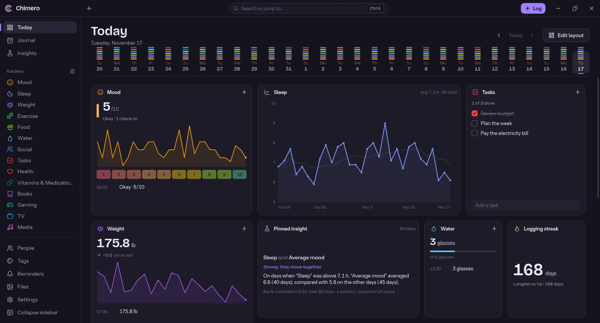

# Chimero

A local-first desktop app for tracking the things you care about. You arrange a dashboard, design your own trackers, log anything in seconds with Alt+Q, and read statistics that never claim more than the data supports. Your data stays in one SQLite file on your machine.



- [Case study and screenshots](portfolio/README.md)
- [Run the synthetic showcase](portfolio/DEMO.md)
- [Plan, decision log and checklist](Documentation/Release/V2_PLAN.md)
- [Verification report](Documentation/Release/VERIFICATION.md)

## Develop

Use Node 22 (`chimero-habit-flow/.nvmrc`) and pnpm 10.28.2.

```sh
cd chimero-habit-flow
pnpm install --frozen-lockfile   # also rebuilds better-sqlite3 for Electron
pnpm dev
```

## Check

```sh
pnpm check-types                     # app and tests
pnpm lint                            # zero warnings allowed
pnpm test                            # unit + integration, run on Electron's Node for the native ABI
python3 scripts/verify-migrations.py
pnpm build
pnpm test:e2e                        # built app, throwaway profiles; needs a display or xvfb-run
```

## Package

```sh
pnpm package                         # Linux AppImage in dist/
pnpm package:win                     # Windows NSIS installer; needs Windows, or wine on Linux
```

`.github/workflows/ci.yml` runs the checks on Linux and builds the Windows installer on Windows, then runs the end-to-end suite against it.

## Layout

| Path | What lives there |
|---|---|
| `chimero-habit-flow/apps/electron/src/main` | Main process: IPC handlers, services, analytics, reminders, data export |
| `chimero-habit-flow/apps/electron/src/renderer` | React interface |
| `chimero-habit-flow/packages/db` | Drizzle schema, migrations, `transact()` |
| `chimero-habit-flow/packages/shared` | Contracts and domain logic shared by both processes (grid engine, statistics) |
| `chimero-habit-flow/tests` | Unit, integration and Electron end-to-end tests |
| `chimero-habit-flow/scripts` | Showcase seeder, packaging hook, migration check |
| `portfolio/` | Case study, screenshots, project metadata |

## Your data

Never delete or reset a personal database to get past an error.

- Migrations only add, and run in one transaction.
- The app keeps a copy in `backups/` before any upgrade, and refuses to start on a schema it doesn't recognise.
- Restoring a backup keeps the database it replaced.
- The showcase and the tests use their own profiles.

## Client material

`Documentation/` and `docs/Client-Requeriments/` include historical client-context documents. They are not part of the portfolio showcase. Get the client's approval before publishing them anywhere.
