# Chimero — your life, in perspective

Chimero is a local-first desktop app for recording the things a person wants to keep track of: weight, mood, sleep, training, food, symptoms, supplements, reading, play, the people in their life, and any variable they define themselves. It puts that record on a dashboard they arrange, and it shows how those records move together over time, honestly. There are no accounts and no cloud. Everything lives in one SQLite file on the user's machine.

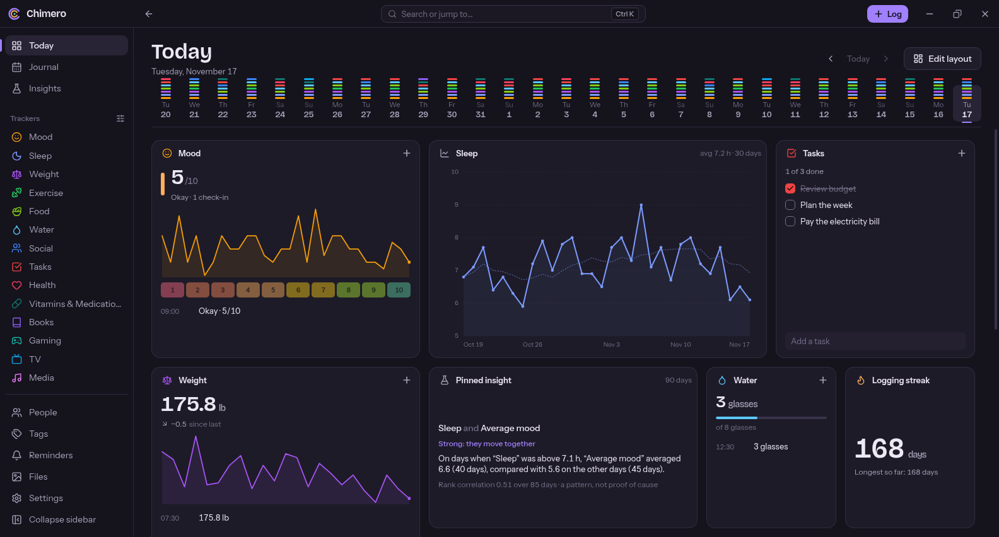

*Every screenshot here is a capture of the running Electron app. The data is a synthetic, fictional profile written through the app's own API (see [DEMO.md](DEMO.md)).*

## The brief

The starting point was a working but uneven product. Specialised trackers and a SQLite schema existed. The interface was a fixed bento grid with "coming soon" tabs. Its "insights" turned two averages into a confidence percentage. One recovery path could delete a user's database when it found a missing column. The goal was to take it to something reliable enough to use every day:

- a dashboard you can actually compose
- trackers that are complete, including ones you design yourself
- logging that takes seconds
- statistics that never claim more than the data supports
- upgrades that cannot cost anyone their records

My role: product definition, interface design, the renderer rebuild, the analytics and grid engines, the persistence fixes, the tests, the packaging and this write-up.

## What it does

**Today** is a 12-column grid of widgets: tracker cards, trend charts, a heatmap, a streak, reminders, people and a pinned insight. You drag a widget to move it and drag a corner to resize it. Other widgets make room and the grid compacts. Each widget type has its own minimum and maximum size, and with a widget focused, arrow keys move it and Shift+arrows resize it. The layout saves as you go, survives restarts, and older saved layouts are upgraded when they're read.

| Edit mode | Quick Entry (Alt+Q) |
|---|---|
| 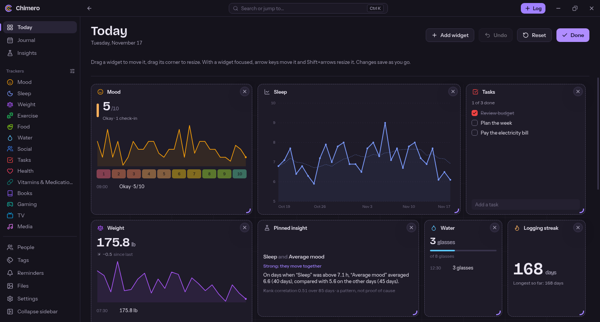 | 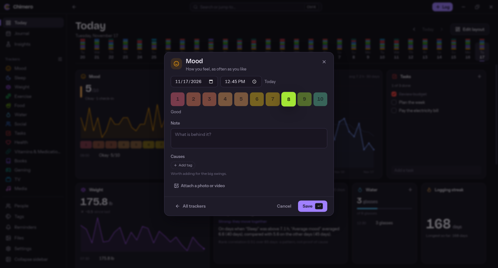 |

**Quick Entry** opens from anywhere with Alt+Q. You type a few letters and press Enter, fill in the form and press Enter again. On a tracker's page it skips the picker. Each kind of record has a form that fits it:

- a 1–10 mood scale
- weigh-ins with an optional waist measurement
- workouts with exercises, sets, reps and load, started from a saved routine
- meals, symptoms with severity, and supplements with dose
- books moving across shelves
- time spent with specific people

**Trackers** have their own pages with stats, a chart and history you can edit. The stats depend on what kind of number the tracker records:

- a reading such as weight or sleep: latest, average, range, fitted trend and distance to goal
- an activity such as minutes or glasses: total, daily average and active days
- a yes/no: days done, share of days, times per week and the last time

Missing days are left out of a reading's statistics instead of being counted as zero. Each tracker page says which rule it follows.

| Weight with a goal | Logging a workout |
|---|---|
| 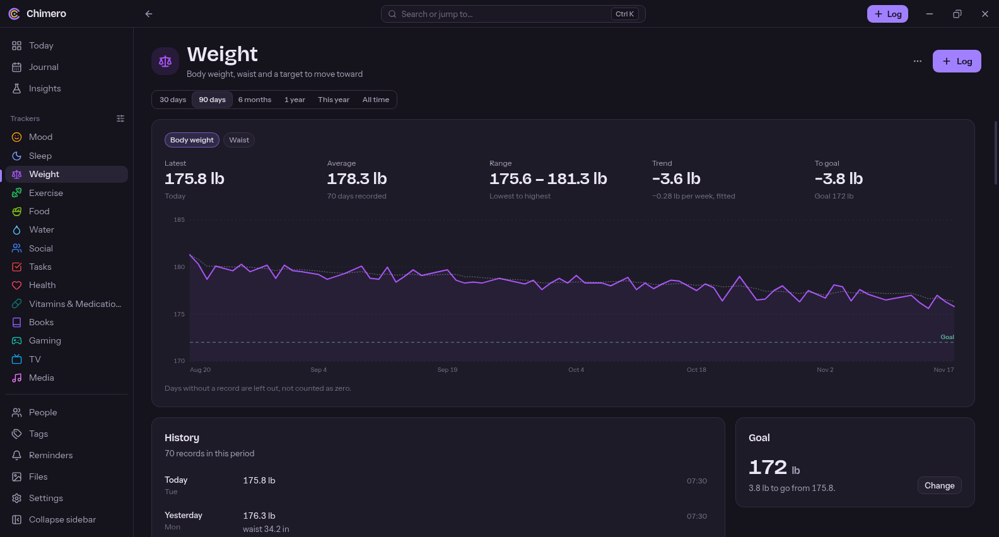 | 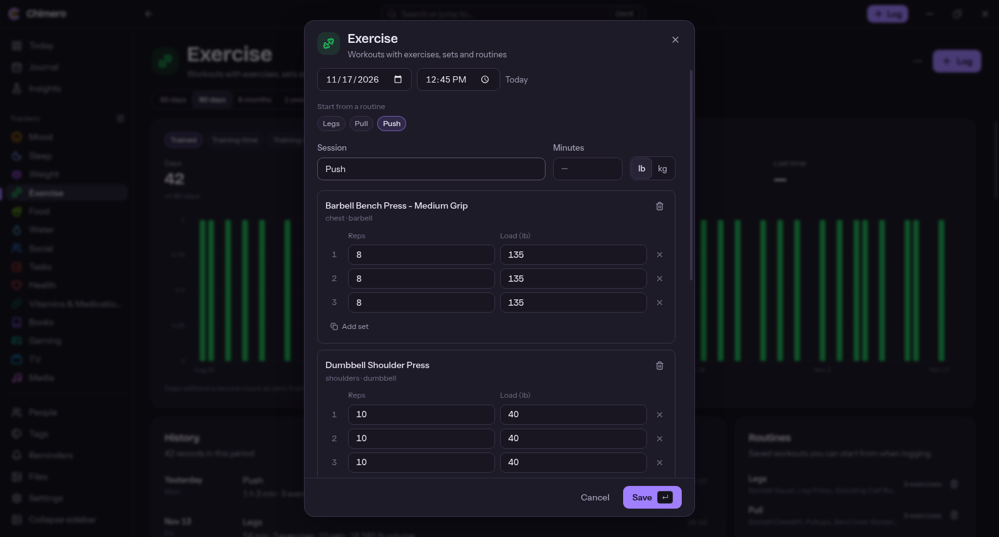 |

**Custom trackers** start blank or from a template: Sleep, Water, Meditation, Steps, Caffeine, Alcohol, Screen time, Energy, Stress, a daily habit or a journal. Each one has:

- a type: number, scale, yes/no or text
- a unit, and a rule for several records in one day (add them up, average them, or keep the latest)
- what an empty day means: zero or unknown
- a daily goal and one-tap amounts
- up to twelve extra fields of their own

They get the same pages, widgets and insights as the built-in trackers.

| A custom Sleep tracker | The tracker builder |
|---|---|
| 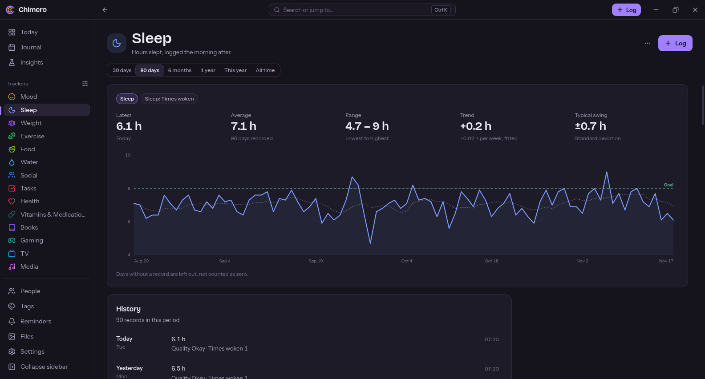 | 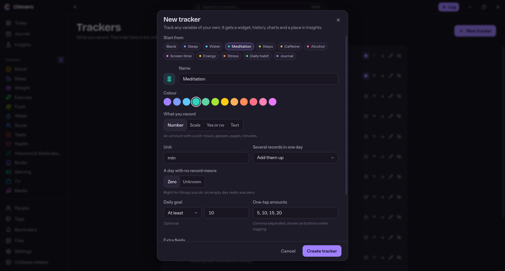 |

**Insights** compares any two metrics on the same day or with a lag of up to three days. It reports how many days were compared, a rank correlation, a p-value in plain words, and the split behind them ("on days when Sleep was above 7.1 h, mood averaged 6.6 over 40 days, compared with 5.6 over 45 days"). It always ends with the reminder that moving together is not proof of cause. A scan lists the strongest patterns across every pair of trackers.

| Sleep and mood, same day | Dairy and bloating, the next day |
|---|---|
| 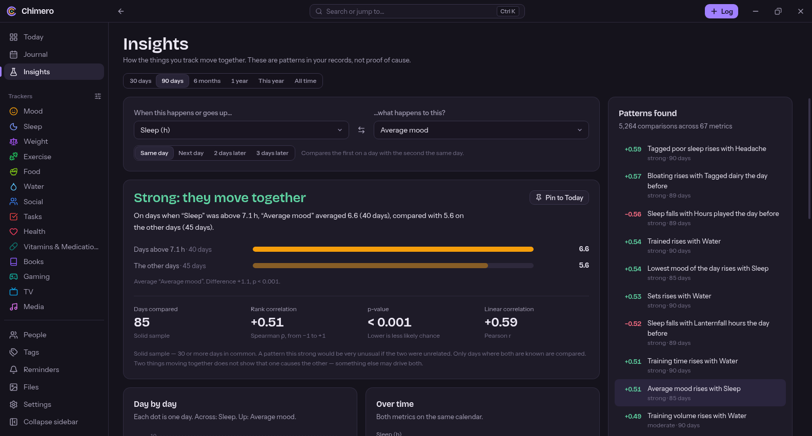 | 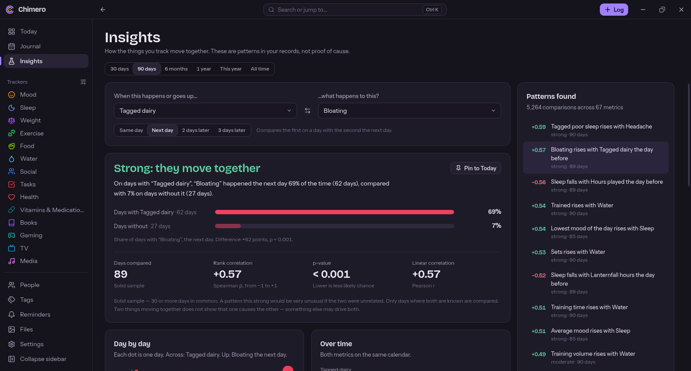 |

**Journal**, **People**, **Tags**, **Reminders**, **Files** and **Settings** complete the app:

- the Journal is a month view of every record
- People is a small CRM with birthdays, likes, nudges to get back in touch and a shared history
- Tags can be grouped into parents, and a tag on a child counts toward its parent in Insights
- Settings covers JSON and CSV export, a full backup and a restore

| Journal | People |
|---|---|
| 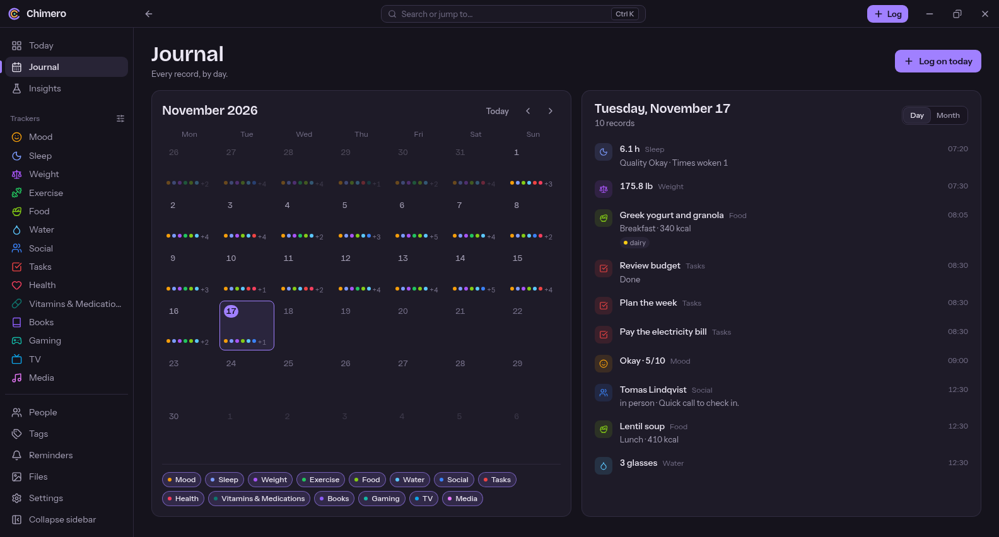 | 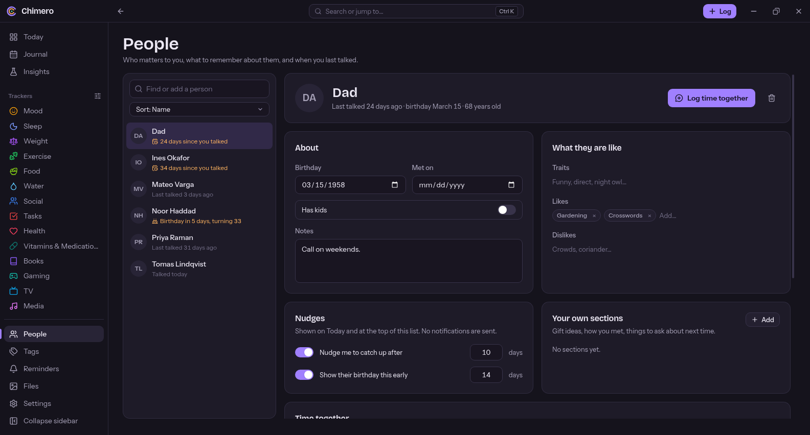 |

There is a light theme as well:

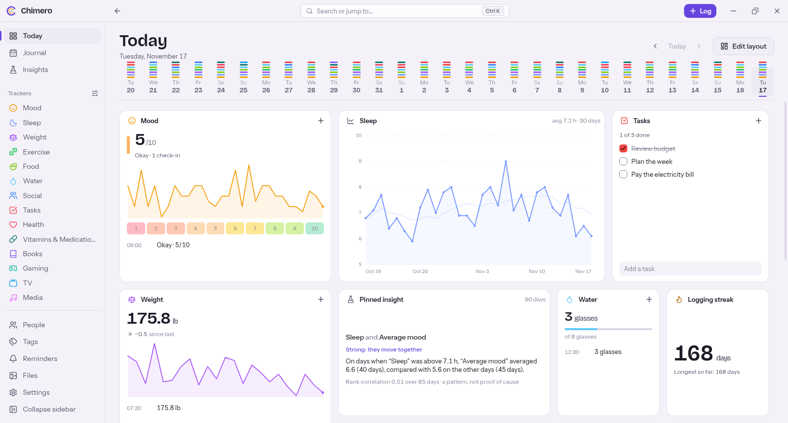

## Engineering

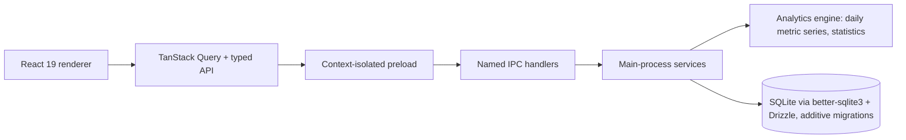

Stack: Electron 40, React 19, TypeScript, Vite, Tailwind, TanStack Query, SQLite (better-sqlite3 and Drizzle), Vitest, Playwright and electron-builder.

### Statistics that do not overclaim

Every tracker exposes daily metric series. A metric is one of three kinds:

- a **reading** (weight, mood, sleep): several readings in one day are averaged, and a day with no reading is *unknown*
- an **activity** (minutes trained, glasses of water): a day without a record is a real zero, but only from the day the tracker was first used
- a **flag** (trained, had dairy): a yes/no for the day

Pairs are compared only on days where both values are known. The scan was the hardest part to make honest. Testing about five thousand pairs at p ≤ 0.05 produces hundreds of chance hits. The first version's top results were tautologies such as "Tagged ice cream" and "Ate ice cream". The scan now:

- applies a Benjamini–Hochberg correction at a 5% false-discovery rate across every comparison it makes
- needs 14 or more shared days
- never compares a tag with the counts of the records it labels
- lists only once any group of findings that carry the same information

In the showcase profile the planted relationships come out on top:

- nights tagged "poor sleep" with headaches
- dairy before next-day bloating
- late gaming before shorter sleep
- sleep with mood

### A bug the mocks were hiding

Building the showcase data through the real API surfaced a serious failure. Saving a book, weigh-in, meal, symptom, supplement, game session, workout or tag edit failed at runtime with "Transaction function cannot return a promise". better-sqlite3 runs transactions synchronously, and the services passed it async callbacks. The unit tests mocked `db.transaction`, so they never noticed.

The fix is a small `transact()` helper. It runs `BEGIN IMMEDIATE`, commits or rolls back, and queues overlapping calls so they never interleave. Integration tests now run every structured write against real SQLite, along with rollback and serialisation.

### Upgrades that keep people's data

- **Additive migrations only.** They run in one transaction, and the app fails closed on a schema it doesn't recognise.
- **A copy before every upgrade.** Before pending migrations touch an existing database, a consistent copy is written with `VACUUM INTO` to `backups/`.
- **Restore keeps what it replaced.** A restore stages the chosen file and swaps it in on the next start, keeping the database it replaced.
- **The upgrade itself is tested.** An end-to-end test builds the database exactly as the previous release left it, with migration history and records in that release's shapes, including the old dashboard layout format. It starts this build on it and checks every record, tag, note and widget came through.

### A dashboard grid as pure functions

Placement, collision, compaction and size limits are pure, unit-tested functions over `{x, y, w, h}`. A pointer-driven canvas and keyboard handlers sit on top of them. That made the layout deterministic and easy to test, and it avoided a third-party grid library that would have needed to keep up with React 19.

### Packaging

The Linux AppImage is built, launched, and passes the end-to-end suite as a packaged binary. A Windows build made on Linux turned out to contain Linux's SQLite binary and would have failed on first launch. An `afterPack` hook now ships the official prebuilt binary for the target platform and checks its format. A CI workflow builds the Windows installer on Windows and runs the same end-to-end suite against it. That workflow has not been run yet, so Windows runtime support is not claimed here.

## Verification

- 171 unit and integration tests
- 12 migration upgrade paths checked on disposable databases
- type checking that covers the tests as well as the app
- lint with zero warnings
- three end-to-end scenarios on the built app and on the packaged binary:
  - build a tracker, then log, edit and delete through the UI, drag and resize on the grid, restart, and check that everything persisted
  - upgrade from the previous release
  - back up, export and restore

The full report is in [VERIFICATION.md](../Documentation/Release/VERIFICATION.md).

## Limits, stated plainly

- Windows packaging is set up and its native module is verified, but the installer has not been run on Windows.
- Desktop notification delivery for reminders depends on the operating system and was not verified.
- Insights describe associations in someone's own records. They are prompts for questions, not findings.
- The renderer bundle is about 1.5 MB of JavaScript, loaded locally. It hasn't been split because there is no network cost.

## Publication note

Every image and dataset here is synthetic and fictional, and safe to publish. The repository's historical `Documentation/` and `docs/Client-Requeriments/` folders contain client-context material. They are not part of this showcase and need the client's approval before any publication.
