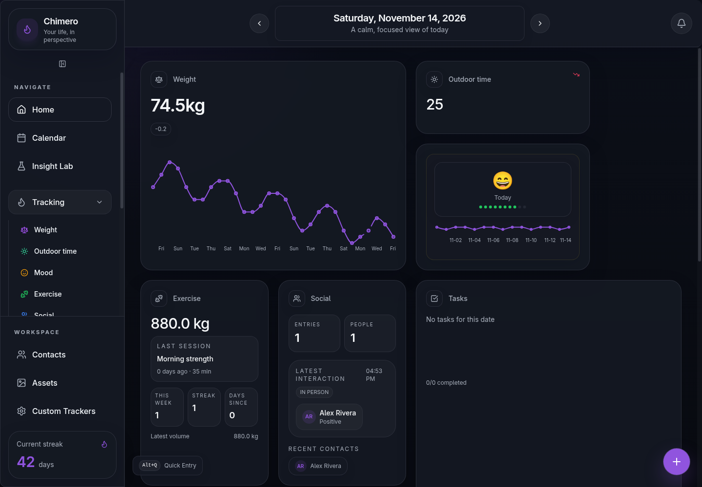
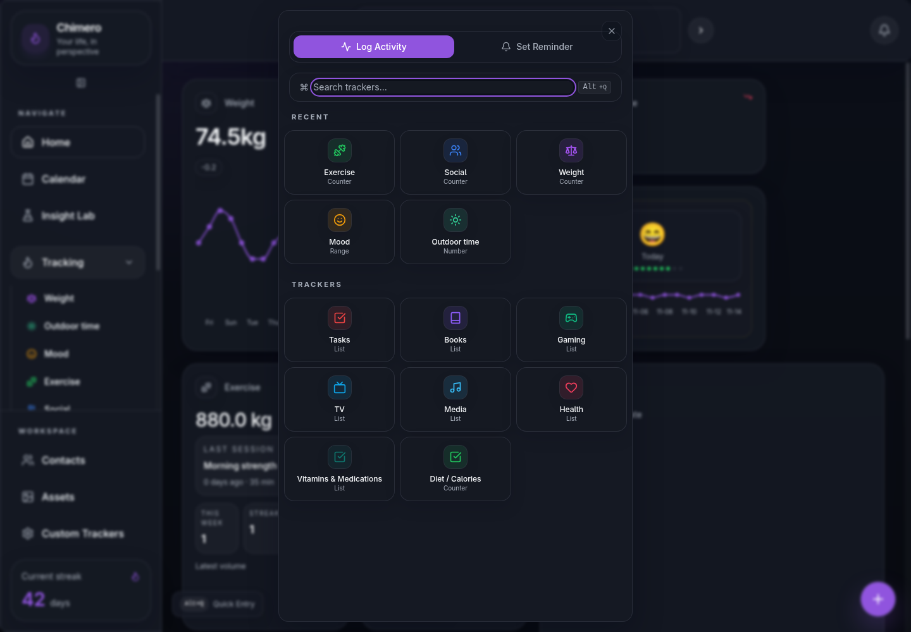
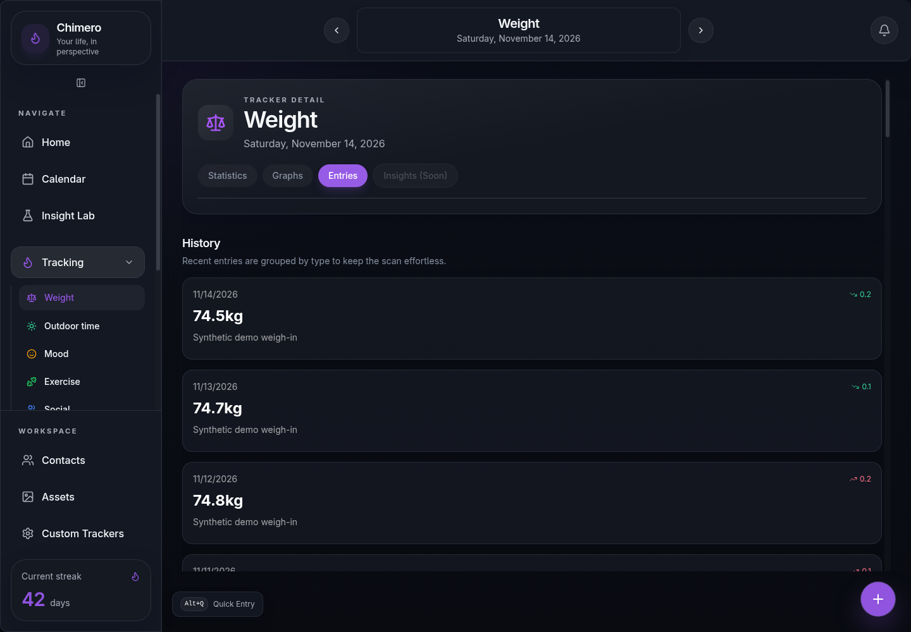
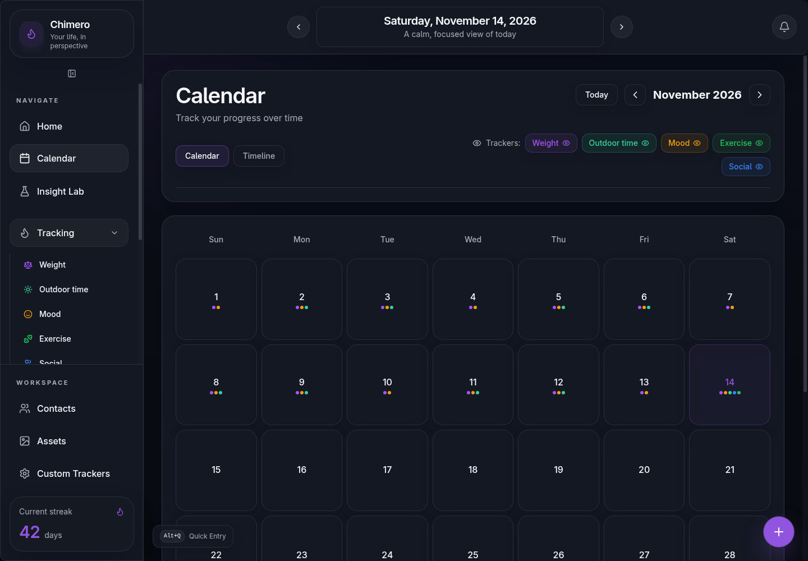
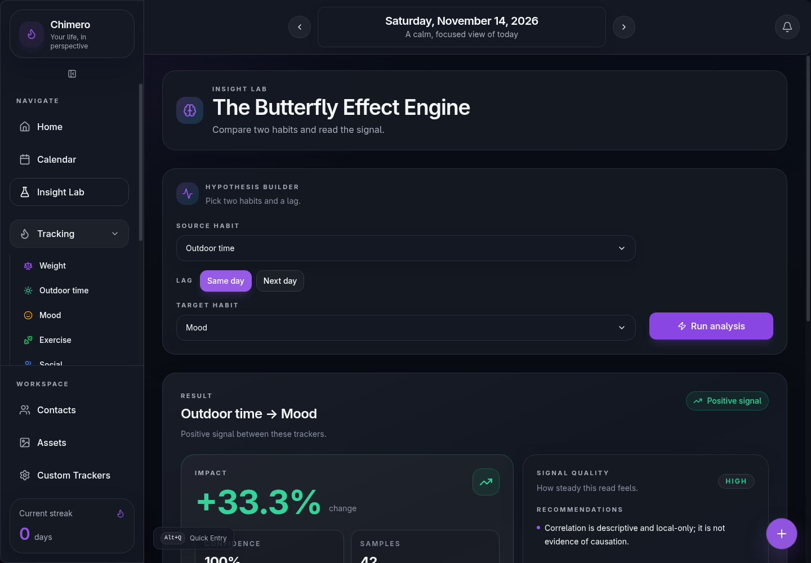
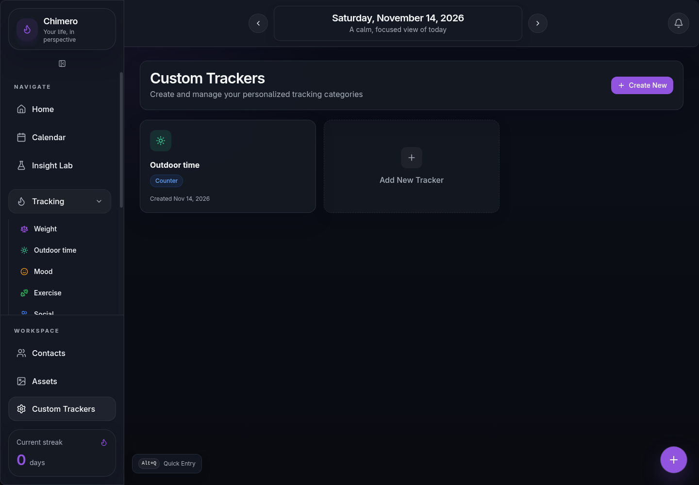
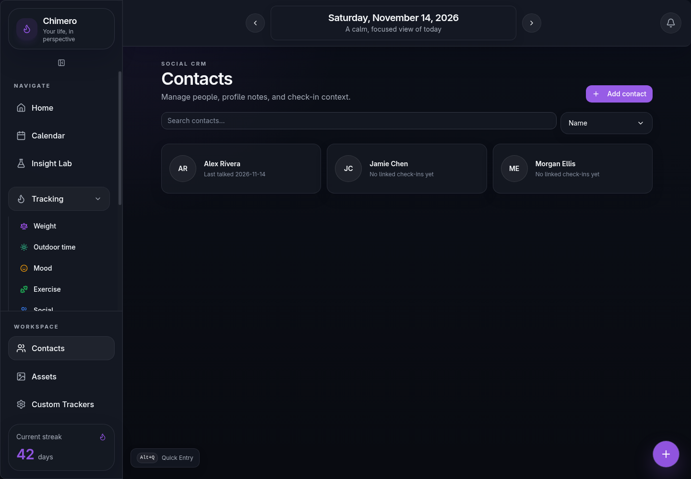
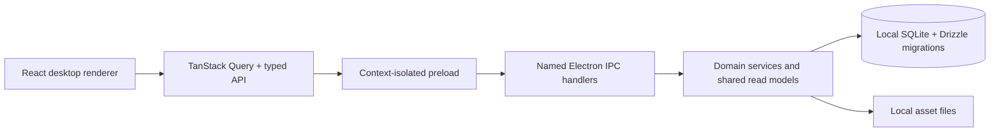

# Chimero — your life, in perspective

Chimero is a local-first desktop application for recording activities, understanding personal history, and exploring relationships between habits. The central interaction is deliberately simple: log quickly on Home, then open a tracker or calendar when you want context.

## The problem

Personal data is often scattered across journals, spreadsheets and specialized apps. Chimero brings daily observations into one local workspace while retaining the structure that makes different activities meaningful. A weight measurement, a workout and a conversation need different fields, histories and validation.

## Product and design

A dark graphite workspace uses violet for primary actions, restrained tracker colors and persistent navigation. The dashboard prioritizes a day's records, while detailed views reveal longer histories. A collapsible sidebar, visible keyboard focus and reduced-motion support make the desktop shell more adaptable.

Quick Entry is accessible with **Alt+Q**. Specialized tracker forms coexist with lightweight custom numeric trackers. Calendar navigation supports historical review; contacts preserve context around social interactions. Insight Lab compares observations from persisted records and must be interpreted as exploratory association, never proof of causation.

| Quick entry | Weight history |
|---|---|
|  |  |

| Calendar | Insight Lab |
|---|---|
|  |  |

| Custom trackers | Contacts |
|---|---|
|  |  |

## Engineering

The desktop uses Electron, Vite, React, TypeScript, SQLite and Drizzle ORM. A context-isolated preload exposes named IPC operations rather than direct database access. Main-process services persist records and compute read models; shared contracts connect those services to the renderer. SQLite migrations establish and upgrade the local schema.

The engineering challenge is consistency: quick entry, tracker history, the calendar and statistics must describe the same stored events. Specialized records and transaction boundaries support this without reducing every activity to an untyped number. Another challenge is honest analytics: missing comparison cohorts and repeated daily observations must not turn into misleading confidence claims.

## Demonstration and evidence

See [DEMO.md](DEMO.md) for setup, isolated profiles and reproduction. These are authentic captures of the running Electron renderer, using fictional records written through the same IPC API as the application. No generated UI or personal client data is used. The dataset contains 42 days of synthetic weight, mood and outdoor-time records, plus fictional contacts, a sample workout, tasks, a meal and a book activity. The apparent association is intentionally synthetic and has no scientific meaning.

The Electron end-to-end test exercises a fresh database, custom tracker and entry creation, editing, layout persistence, a complete process restart, restored reads, calendar navigation and deletion. It passed on the Linux host during this work. This does not establish Windows installer compatibility or exhaustive tracker coverage. Refer to the repository release verification report for the complete check results.

## Honest limits

Custom trackers remain lightweight configurable trackers, not a full relational schema builder. Correlation results are descriptive observations and cannot establish causality. Not every historical feature request is implemented. Windows installation, platform-specific notifications and long-term performance require additional platform testing. There are no claimed startup or memory benchmarks.

The portfolio material is synthetic and suitable for review independently of historical client-context documents. Review ownership and publication rights before publishing any original client documentation or assets.

## Portfolio integration

Copy this directory into your portfolio assets and use [project.json](project.json) for the project card, technology tags, gallery paths and accessible image descriptions. Use `screenshots/08-desktop-hero.png` as the wide cover. Images are unmodified captures of actual application states; do not describe the synthetic comparison as a personal or scientific finding.

### Architecture at a glance

### Engineering highlights

- Preserved user records by replacing destructive schema recovery with additive repair and fail-closed behavior.
- Kept structured tracker edits consistent across entry forms, history and calendar views.
- Averaged repeated daily observations and required actual comparison cohorts instead of inventing statistical evidence.
- Verified persistence through a full desktop-process restart and tested upgrades from eleven historical migration stages.
- Made the demonstration reproducible through real IPC writes and a separate, explicitly completed synthetic profile.

The detailed [verification report](../Documentation/Release/VERIFICATION.md) separates runtime evidence from remaining platform and product limitations.
